# 第 4 章：GPT-1、BERT、GPT-2 与 GPT-3

来源：`4.1 大模型进阶(GPT 123.Bert) 2026秋.pptx`，86 页。逐步展开页按主题合并。论文表格、曲线和实验图保留课件原图，所有成绩均为所述论文的历史结果。

## 目录

- [模型结构、时间线与预训练范式](#models)
- [GPT-1：预训练目标与计算过程](#gpt1-pretrain)
- [GPT-1：监督微调与四类任务输入](#gpt1-finetune)
- [GPT-1：规模、训练设置与实验](#gpt1-experiments)
- [BERT：双向表示、MLM、NSP 与微调](#bert)
- [GPT-2：WebText、扩大规模与零样本迁移](#gpt2)
- [GPT-3：上下文学习与三种评估设置](#gpt3-icl)
- [GPT-3：模型规模、数据与训练](#gpt3-training)
- [GPT-3：评估方法、Scaling Law 与结果](#gpt3-evaluation)
- [GPT-3：局限性、偏见与误用](#gpt3-limitations)

<a id="models" name="models"></a>
## 1. 模型结构、时间线与预训练范式

**对应课件第 2–6 页。** Transformer 的 Encoder 将 token embedding、位置信息送入多层双向 self-attention 和逐位置 FFN，输出每个位置的上下文表示。Decoder 在因果掩码下逐步预测后续 token。原始 Encoder–Decoder 的 Decoder 还包含读取 Encoder 输出的 cross-attention。残差连接和归一化帮助信息与梯度传播。6 层、12 层是具体配置，层数并非结构定义。

完整计算沿用[第 3 章 Encoder](03-transformer.md#encoder)、[因果掩码与解码](03-transformer.md#autoregressive)，此处集中保留后续模型的区别。

| 类型 | 注意力与输出 | 典型用途与课件例子 |
|---|---|---|
| Encoder-only | 每个输入位置可读取左右上下文，输出表示 | BERT；分类、抽取式问答、序列标注 |
| Encoder–Decoder | Encoder 编码输入，Decoder 因果生成并 cross-attend 输入 | 原始 Transformer、T5；翻译等条件生成 |
| Decoder-only | 对串接文本做因果 self-attention，无独立 Encoder | GPT 系列；续写、任务提示下的生成 |

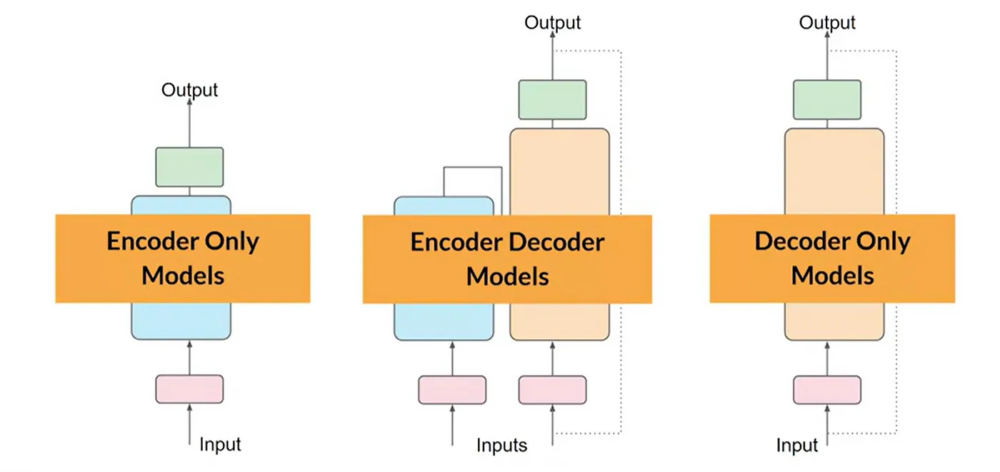

课件时间线依次为 Transformer（2017.06）、GPT-1（2018.06）、BERT（2018.10）、GPT-2（2019.02）、GPT-3（2020.05）。重复的模型谱系见[第 1 章历史](01-neural-networks.md#history)。论文引用量随时间变化，不保留为技术指标。

预训练用大规模文本建立通用参数，微调用任务数据调整参数。早期词嵌入主要迁移词级特征，GPT-1 把迁移对象扩展到可表达句子、段落与较长依赖的语言模型，尽量通过输入格式和小型输出头适配任务。NLP 面临两类问题：有效的预训练目标难以选择，以及学到的表示如何统一迁移到差别很大的任务。

**表述边界：**课件以 ImageNet 说明视觉领域的预训练经验，但“图片信息总是大于句子”“GPT 首次把预训练用于 NLP”等说法不构成普遍事实。ELMo、ULMFiT 等已有利用未标注文本的工作。GPT-1 的贡献应放在当时统一 Transformer 迁移框架及其实验中理解。

<a id="gpt1-pretrain" name="gpt1-pretrain"></a>
## 2. GPT-1：预训练目标与计算过程

**对应课件第 7–17 页。** GPT 为 Generative Pre-Training。第一阶段不需要人工标注任务标签，以文本本身的下一个 token 为监督信号。原论文使用“无监督预训练、半监督框架”等历史称呼；按监督信号的来源，语言模型预训练也称自监督学习。

### 2.1 对数似然

设未标注语料为 $\mathcal U$ ，token 为 $u_i$ ，上下文窗口长度为 $k$ ，模型参数为 $\Theta$ ：

$$
L_1(\mathcal U)=\sum_i\log P(u_i\mid u_{i-k},\ldots,u_{i-1};\Theta).
$$

最大化这个目标等价于提高真实文本的条件概率乘积。实现时通常最小化其负值或平均交叉熵。取对数把乘积变成加法，避免许多小概率相乘导致数值下溢，也便于求导和累积。模型学习真实序列的概率，并非逐字复原某一篇输入文章。

更长的 $k$ 提供更远的上下文，也增加计算和显存需求，不保证能力单调提高。Decoder-only 的因果掩码阻止预测位置读取未来答案。BERT 的双向完形填空目标与此不同，但不能据此断言哪条路线“技术更简单”或能力上限必然更高。

### 2.2 输入、Transformer 与词表投影

以下采用 token 为行的矩阵约定。设上下文 $U=(u_{-k},\ldots,u_{-1})$ 的离散表示经过 embedding 查表后得到：

$$
h_0=UW_e+W_p,
\qquad h_\ell=\mathrm{TransformerBlock}_\ell(h_{\ell-1}),
\quad \ell=1,\ldots,L.
$$

$$
P(u\mid U)=\mathrm{softmax}\!\left(h_{L,\mathrm{last}}W_e^\top\right).
$$

$W_e$ 为 token embedding， $W_p$ 为可学习位置表示。Transformer block 保持序列长度和隐藏宽度，最后位置的表示投影到词表，softmax 输出下一 token 的分布。这里共享输入 embedding 与词表输出权重，转置方向随行/列向量约定变化。注意“维度不变”指 block 输入输出宽度，并非说内部 QKV 或 FFN 不做投影。


来源：[Improving Language Understanding by Generative Pre-Training](https://cdn.openai.com/research-covers/language-unsupervised/language_understanding_paper.pdf)。

<a id="gpt1-finetune" name="gpt1-finetune"></a>
## 3. GPT-1：监督微调与四类任务输入

**对应课件第 18–26 页。** 给定序列 $x^1,\ldots,x^m$ 和标签 $y$ ，取最后一个抽取位置的顶层表示 $h_m^L$ ，增加任务输出矩阵 $W_y$ ：

$$
P(y\mid x^1,\ldots,x^m)=\mathrm{softmax}(h_m^LW_y),
\qquad L_2(\mathcal C)=\sum_{(x,y)\in\mathcal C}\log P(y\mid x).
$$

输出维度等于标签数。GPT-1 微调更新预训练参数，并训练新增任务头及分隔符 embedding。语言建模可作为辅助目标：

$$
L_3(\mathcal C)=L_2(\mathcal C)+\lambda L_1(\mathcal C).
$$

这里最大化 $L_3$ 。原论文报告辅助语言目标改善泛化、加速收敛。 $\lambda$ 是权衡超参数，不应把“分类损失”和“对数似然”混用同一最小化符号。

### 3.1 统一任务输入

| 任务 | 输入组织 | 预测方式 |
|---|---|---|
| 分类 | `Start Text Extract` | 取 `Extract` 的表示，线性层与 softmax 分类 |
| 文本蕴涵 | `Start Premise Delim Hypothesis Extract` | 判断前提是否蕴涵假设，保持两个文本的方向 |
| 相似度 | 分别构造 `Start Text1 Delim Text2 Extract` 和交换顺序的版本 | 两路表示相加后分类，显式消除输入交换的不对称性 |
| 多项选择 | 每个候选分别构造 `Start Context Delim Answer_i Extract` | 每路生成候选得分，最后对全部候选做 softmax |

`Start`、`Delim`、`Extract` 是图中的特殊 token 角色名称，实现应使用专用 token ID，不能把普通单词当成同一特殊符号。四种任务使用相同的中间 Transformer，改变的是序列组织与输出头。

相似任务可写为 $s=W_y(h_{A,B}+h_{B,A})$ 。多选题的候选得分 $s_i$ 转成：

$$
P(i\mid \mathrm{context})=\frac{e^{s_i}}{\sum_j e^{s_j}}.
$$

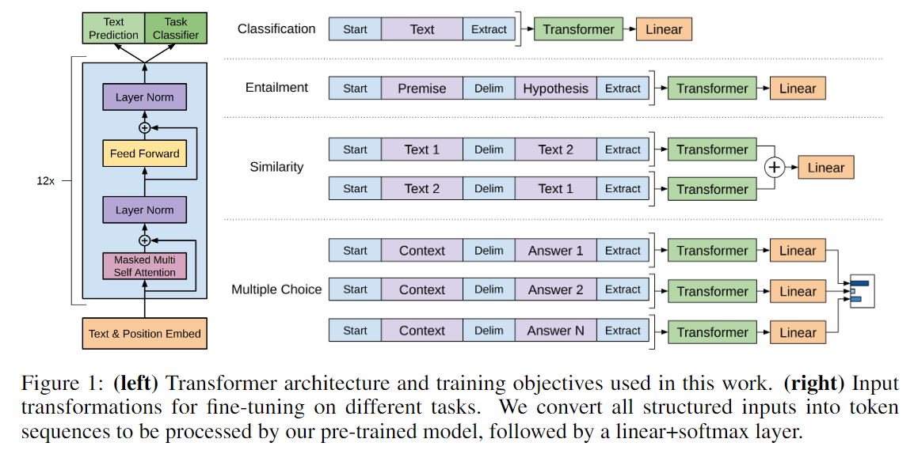

候选分别成序列并组成 batch，可防止候选在同一注意力序列中互相干扰。若有 $M$ 个长度近似为 $n$ 的候选，注意力打分约需 $M n^2$ 的规模；将全部候选串成一个长度 $Mn$ 的序列则约为 $M^2n^2$ 。并行主要改善执行方式，候选总计算并未消失。任务专用头、标注数据、特殊 token 学习和每任务微调仍增加迁移成本。

### 3.2 与现代微调的关系

课件第 21 页提出：预训练规模变大、任务目标差异、LoRA/Adapter/低学习率、分阶段训练，可能使早期混合目标不再是默认选择。这些是工程考虑，不能推出“LoRA 可保证防止遗忘”或“现代微调无需语言建模”。生成式指令微调通常仍使用目标回答的下一 token 交叉熵，只是常对提示部分不计损失；分类微调、生成式 SFT 和预训练语料辅助损失需分别说明。

<a id="gpt1-experiments" name="gpt1-experiments"></a>
## 4. GPT-1：规模、训练设置与实验

**对应课件第 27–30 页及设置截图。** GPT-1 使用 BooksCorpus，包含超过 7,000 本未公开发表的书籍，约 800M **words**。这里 M 表示百万，不能把 800M 直接当作文件字节数。长篇连续文本保留了远程结构，和按句打乱的 1B Word Benchmark 不同。

课件截图中的全部训练设置如下：

| 项目 | GPT-1 设置 |
|---|---|
| 参数量 | 约 117M |
| Transformer 层数 | 12 |
| 隐藏宽度 / 注意力头 | 768 / 12，每头 64 |
| FFN 中间维度 / 激活 | 3,072 / GELU |
| 位置表示 | 可学习 embedding，未采用固定正弦编码 |
| 优化器 / 最大学习率 | Adam / 2.5×10⁻⁴ |
| 调度 | 前 2,000 次更新线性预热，之后余弦退火到 0 |
| 训练 | 100 epochs，batch 为 64 个连续片段，每段 512 tokens |
| 权重初始化 | 正态分布，标准差 0.02 |
| BPE | 40,000 次合并 |
| Dropout | residual、embedding、attention 均为 0.1 |
| 权重正则 | 修改的 L2 正则，系数 0.01，非 bias、gain 权重 |
| 文本处理 | ftfy 清洗、统一标点和空白、spaCy 分词 |

任务组完整保留：NLI 使用 SNLI、MultiNLI、QNLI、RTE、SciTail；问答/常识使用 RACE、Story Cloze；相似度使用 MRPC、QQP、STS-B；分类使用 SST-2、CoLA，共 12 个任务。课件用 GPT-1 与 RNN、BiLSTM+Attention 等历史系统比较，报告 12 项中 9 项达到当时最好成绩。

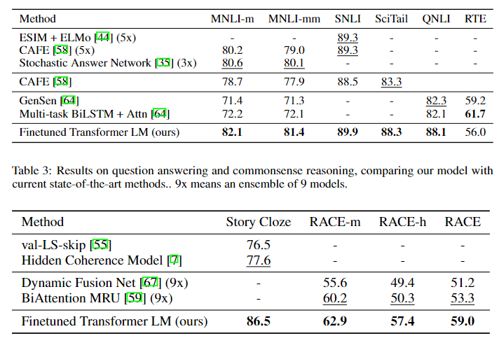

下图保留 GPT-1、BERT-Base、BERT-Large 与历史方法在同一 GLUE 表中的全部成绩。BERT-Base 的各列成绩和平均值优于这里的 GPT-1 行，结论只限于所示实验设置，不能扩大成所有任务上的全面胜出。

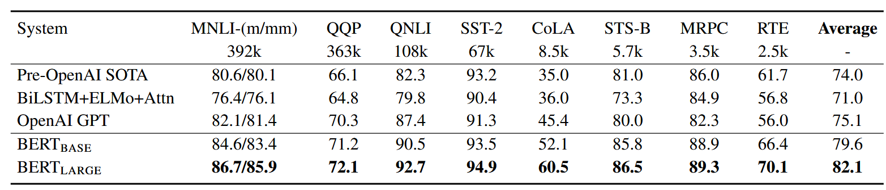

<a id="bert" name="bert"></a>
## 5. BERT：双向表示、MLM、NSP 与微调

**对应课件第 31–44 页。** BERT 为 Bidirectional Encoder Representations from Transformers，采用深层双向 Encoder-only 表示，预训练后针对下游任务微调参数和小型输出头。

### 5.1 ELMo、GPT 与 BERT

| 模型 | 预训练结构与方向 | 下游使用 |
|---|---|---|
| ELMo | 分别训练从左到右、从右到左的 LSTM 语言模型，再组合表示 | 原始方案主要把上下文特征输入任务模型 |
| GPT-1 | 因果 Transformer，只读取当前及左侧历史 | 任务输入变换后端到端微调 |
| BERT | 每一层可融合左右上下文的 Transformer Encoder | 微调预训练模型及分类/抽取/标注头 |

ELMo 的**整体特征是双向的**，其中两个语言建模目标各自单向。课件把它直接称为“单向模型”或“不能端到端微调”过于绝对。T5 是 Encoder–Decoder Transformer，不能与 ELMo 的 LSTM 架构混为一类。BERT 的动机是避免单向表示限制句级语义判断及 token 级抽取任务，而非否定因果生成模型的用途。

### 5.2 规模与计算

| 模型 | 层数 L | 隐藏宽度 H | 头数 A | 每头维度 | 参数 |
|---|---:|---:|---:|---:|---:|
| BERT-Base | 12 | 768 | 12 | 64 | 110M |
| BERT-Large | 24 | 1,024 | 16 | 64 | 340M |

课件关系 $H=A\times64$ 在这两个配置成立。Base 便于与 GPT-1 比较。BERT 两个尺寸都使用 BooksCorpus（800M words）和英文 Wikipedia（2,500M words），不是 Large 才使用三倍数据。Wikipedia 提取正文、忽略列表、表格和标题，强调保留文档内连续句子供 NSP 使用。

**复杂度勘误：**层数与宽度的影响需区分序列长度。令序列长为 $N$ 、层数为 $L$ 、隐藏宽度为 $H$ ，且 FFN 宽度与 $H$ 同比例，主要计算近似为：

$$
O(LNH^2+LN^2H).
$$

固定其他配置时，投影/FFN 部分随层数线性、宽度平方增长。宽度 768→1,024 的比值平方为 $16/9\approx1.78$ ，再乘层数翻倍约为 3.56。课件的“两倍”只可作粗略描述， $O(N^2)$ 不能用未定义的 N 同时代表宽度和序列长度。

### 5.3 输入表示与 CLS

$$
E_i=E_i^{\mathrm{token}}+E_i^{\mathrm{position}}+E_i^{\mathrm{segment}}.
$$

输入通常为 `[CLS] Sentence A [SEP] Sentence B [SEP]`。Token embedding 表示词片，position embedding 表示位置，segment embedding 区分 A/B 句子。单句任务也保留 `[CLS]` 和 `[SEP]`。原始 BERT 使用约 30,000 的 WordPiece 词表。

`[CLS]` 在句首参与全局注意力。其最终状态 $C$ 受预训练和下游损失训练，可用于分类；不能把尚未训练的 CLS 向量自动视为完整语义摘要。其他位置最终状态 $T_i$ 用于 token 任务。

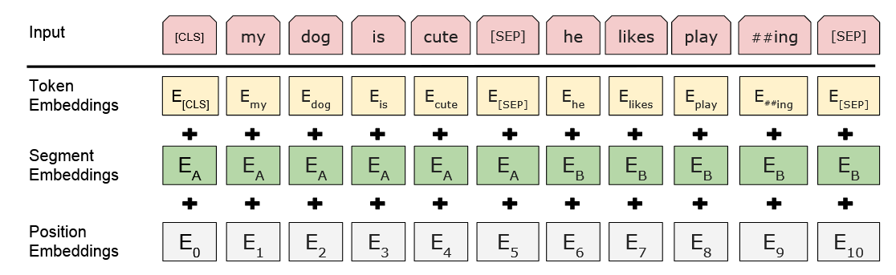

### 5.4 Masked Language Model（MLM）

随机选择约 15% 的 token 位置作为预测目标。对**选中的位置**：80% 替换成 `[MASK]`，10% 替换成随机 token，10% 保持原 token。因此约占全部位置的 12%、1.5%、1.5%，三者的分母不同。

课件例子 `my dog is hairy` 的目标 `hairy` 可变为 `my dog is [MASK]`、`my dog is apple`，或保持 `my dog is hairy`；三种都要求预测原词 `hairy`。不总使用 MASK 是为了减轻预训练中的 MASK 与下游正常文本之间的分布不一致。

补充目标公式，设选中位置集合为 $\mathcal M$ ，被扰动文本为 $\widetilde x$ ：

$$
\mathcal L_{\mathrm{MLM}}=-\sum_{i\in\mathcal M}\log P(x_i\mid\widetilde x).
$$

损失只计算选中位置，包括保持原词的位置。MLM 允许从目标左右读取上下文，与直接把待预测原词暴露给所有训练目标的普通双向下一词预测不同。

### 5.5 Next Sentence Prediction（NSP）

给定 A/B 两段，50% 为真实后续文本（IsNext），50% 为从语料随机采样的 B（NotNext）。使用 CLS 状态做二分类，和 MLM 联合训练。课件的正例是购买牛奶的一段连续文本，反例把商店句子与企鹅飞行句子拼在一起。

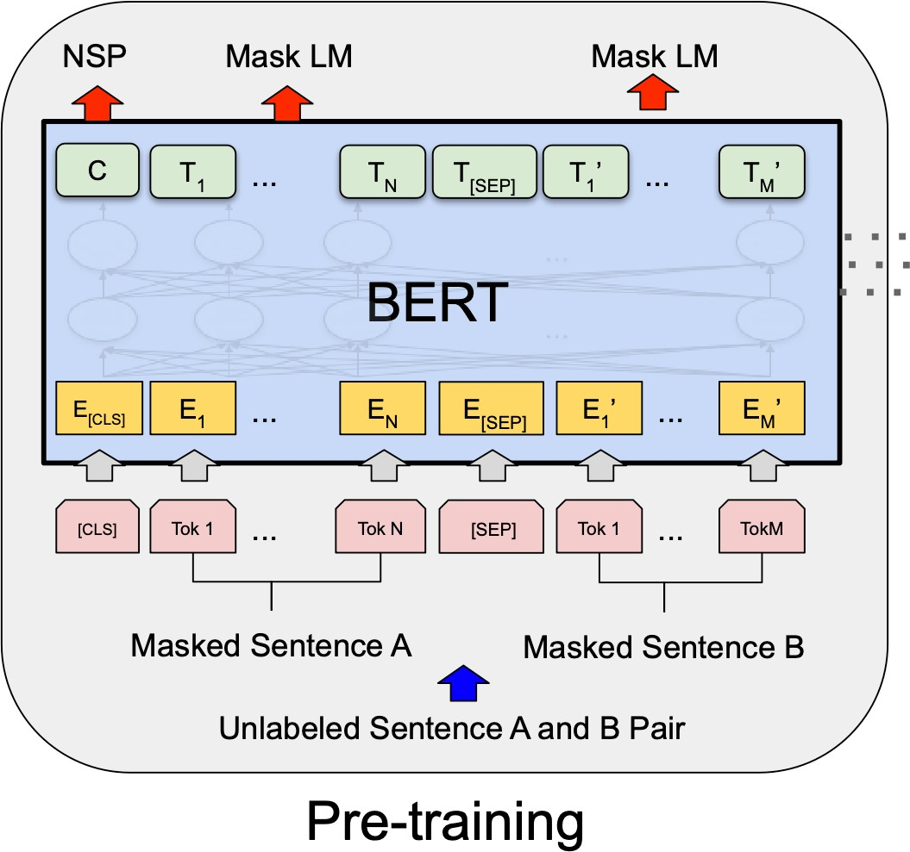

课件写“NSP 实际没起作用”，需注明实验范围：BERT 原始消融认为移除 NSP 会伤害部分任务；后续 [RoBERTa](https://arxiv.org/abs/1907.11692) 在改进训练配置后移除 NSP 仍取得更好结果。因此 NSP 不是所有语言模型都必需，后续结果也不等于它在所有设置完全无用。

### 5.6 分类与抽取式问答

分类：对于 $K$ 个标签增加 $W\in\mathbb R^{K\times H}$ ，以 $C$ 的线性投影做 softmax，最小化真实标签交叉熵，同时微调 BERT。单句分类与句对分类的主干相同。

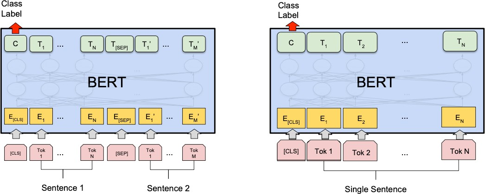

抽取式问答：把问题设为 segment A、文章为 segment B，答案在文章内部。增加起点向量 $S$ 和终点向量 $E$ ：

$$
p_i^{\mathrm{start}}=\frac{e^{S^\top T_i}}{\sum_{j\in\mathrm{passage}}e^{S^\top T_j}},
\qquad
p_i^{\mathrm{end}}=\frac{e^{E^\top T_i}}{\sum_{j\in\mathrm{passage}}e^{E^\top T_j}}.
$$

$$
(i^*,j^*)=\arg\max_{i\le j}\left(S^\top T_i+E^\top T_j\right),
\qquad
\mathcal L_{\mathrm{QA}}=-\log p_{i_{\mathrm{gold}}}^{\mathrm{start}}-\log p_{j_{\mathrm{gold}}}^{\mathrm{end}}.
$$

选择合法的起止片段，不能简单分别取两路最大值后得到终点早于起点的区间。课件引用 SQuAD v1.1，约 100k 众包问答对；截图中的微调设置为 3 epochs、学习率 5×10⁻⁵、batch 32。

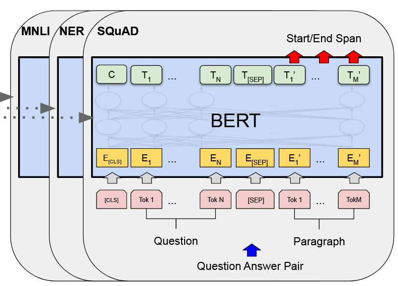

来源：[BERT: Pre-training of Deep Bidirectional Transformers for Language Understanding](https://arxiv.org/abs/1810.04805)。

<a id="gpt2" name="gpt2"></a>
## 6. GPT-2：WebText、扩大规模与零样本迁移

**对应课件第 45–59 页。** GPT-2 继续使用因果 Decoder-only 路线，将数据与模型扩大，重点评估不用针对目标任务更新参数的 zero-shot 迁移。BERT 的理解任务成绩更好，并不意味着因果生成架构已经被全面淘汰，两个工作的目标和评估方式不同。

### 6.1 多任务学习与自然语言提示

传统单任务学习在一个数据集上优化指定任务。多任务训练把多个任务损失结合，试图共享表示。预训练后逐任务微调则仍需标注数据、更新权重、训练输出头或特殊 token，迁移到新任务存在成本。

GPT-2 把任务意图作为自然语言条件。概念上由 $P(\mathrm{output}\mid\mathrm{input})$ 扩展为 $P(\mathrm{output}\mid\mathrm{input},\mathrm{task})$ 。例如输入出现 `translate to french`、`answer the question` 等模式，模型按语言模型方式续写，不另外训练任务分类头。

“不新增任务专用符号”指不临时加入没有学过的 GPT-1 式任务 token，不能理解为 GPT-2 完全没有 tokenizer 特殊 token。也不能把 zero-shot 定义扩大为“模型可无误完成所有任务”。

### 6.2 WebText 数据

Wikipedia、小说等语料之外，网页可提供更丰富任务模式。Common Crawl 规模大，但抓取文本包含噪声，需要质量过滤。GPT-2 用 Reddit 上获得至少 3 karma 的外链作为人类筛选信号，收集约 4,500 万链接，清洗、去重后形成约 800 万文档、40GB 的 WebText。训练集排除了 Wikipedia 文档，以减轻与评测集的重合。

Karma 是质量代理信号，不能保证每个页面正确或高质量。课件提到本实验室网页资源，仅是资源举例，删去与模型方法无关的宣传。数据清洗、连续文本、质量与去重本身属于技术要点。

### 6.3 四个模型与结果

| 课件论文表标注参数 | 层数 | 隐藏宽度 |
|---:|---:|---:|
| 117M | 12 | 768 |
| 345M | 24 | 1,024 |
| 762M | 36 | 1,280 |
| 1,542M | 48 | 1,600 |

这里忠实保留论文表中的参数标注，不把后续发布配置的命名混入表格。较小模型便于与 GPT-1、BERT-Large 的尺寸比较，这不表示后两者用了不同的 BERT 预训练语料。

补充论文所述结构变化：LayerNorm 移到子层输入处（Pre-LN），最后 block 后增加 LayerNorm，调整残差权重初始化以考虑深度，词表增至 50,257，窗口由 512 增至 1,024 tokens，batch 512。初始化缩放依据论文定义的残差层数。完整 [Pre/Post-LN 与调度解释](03-transformer.md#normalization) 不在此重复。

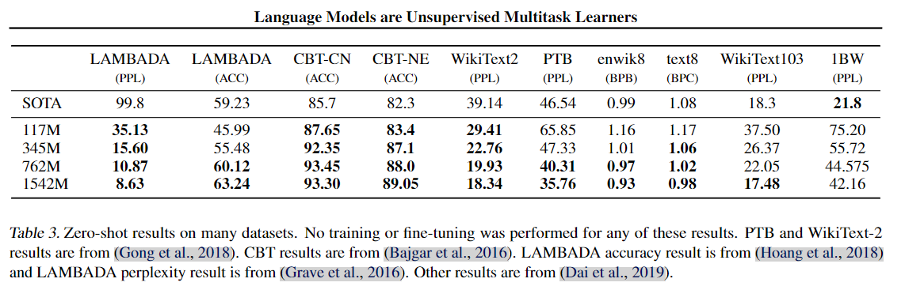

上表保留 LAMBADA 的困惑度与准确率、CBT-CN/NE、WikiText-2、PTB、enwik8、text8、WikiText-103、1BW 等列。不同列的分数单位与优劣方向不同，不能直接把所有数字平均。论文报告在八个语言建模数据集中的七个达到当时最好结果，但阅读理解、翻译、摘要和开放问答还存在较大差距。

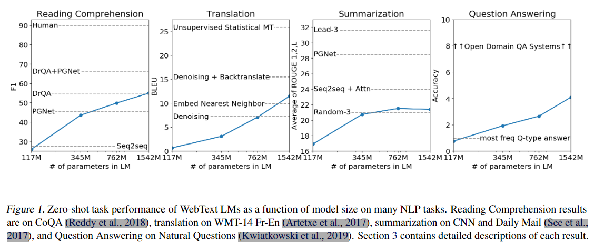

课件强调扩大规模时这些任务表现改善，支持继续研究该路线，并不构成达到通用人工智能或超越所有有监督系统的证明。

来源：[Language Models are Unsupervised Multitask Learners](https://cdn.openai.com/better-language-models/language_models_are_unsupervised_multitask_learners.pdf)。

<a id="gpt3-icl" name="gpt3-icl"></a>
## 7. GPT-3：上下文学习与三种评估设置

**对应课件第 60–73 页。** GPT-3 是最大 175B（1,750 亿参数）的自回归模型。预训练会更新权重，论文的 zero/one/few-shot **任务评估阶段不做梯度更新，也不微调**。课件第 61 页写“给少量样本微调”与后文矛盾，应按 in-context learning（ICL，上下文学习）解释。论文同时报告三种设置，并未放弃 zero-shot。

动机包括：为每项任务标注与微调成本高；在重合训练/评测数据上取得好成绩不必然证明泛化；人类常能通过少量示范理解任务。评测需考察数据污染，而非把所有高成绩自动归因于记忆。

### 7.1 课件的完整英译法提示例子

| 设置 | 演示样本数 | 是否更新任务权重 |
|---|---:|---|
| Zero-shot | 0，只给任务说明与待处理输入 | 否 |
| One-shot | 1 | 否 |
| Few-shot | 多个，论文常取 10–100，受窗口限制 | 否 |
| 监督微调 | 训练数据集 | 是，计算损失并反向传播 |

```text
Zero-shot:
Translate English to French:
cheese =>

One-shot:
Translate English to French:
sea otter => loutre de mer
cheese =>

Few-shot:
Translate English to French:
sea otter => loutre de mer
peppermint => menthe poivrée
plush giraffe => girafe peluche
cheese =>
```

这些字符串来自课件图例。微调对示例的标签做损失并更新参数，而 ICL 只是把示范作为上下文，利用前向计算得到下一个输出分布。

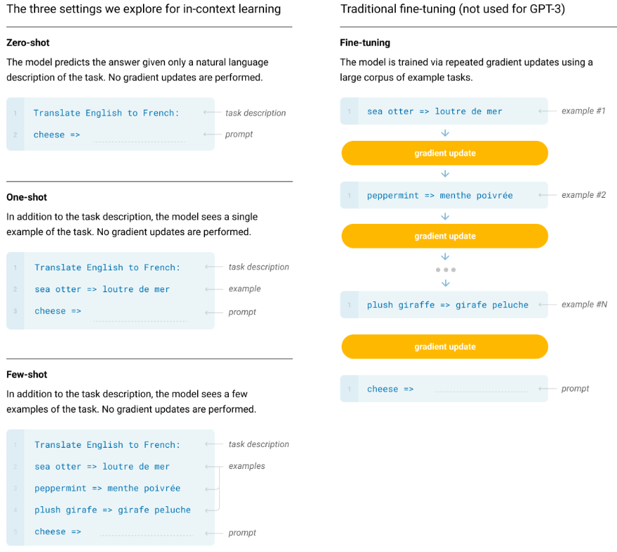

### 7.2 Meta-learning 的解释与限制

课件把大规模预训练比作“外循环”，把依靠提示适应当前任务比作“内循环”。外循环使用 SGD 改变参数，内循环在固定参数下通过上下文改变激活与预测。

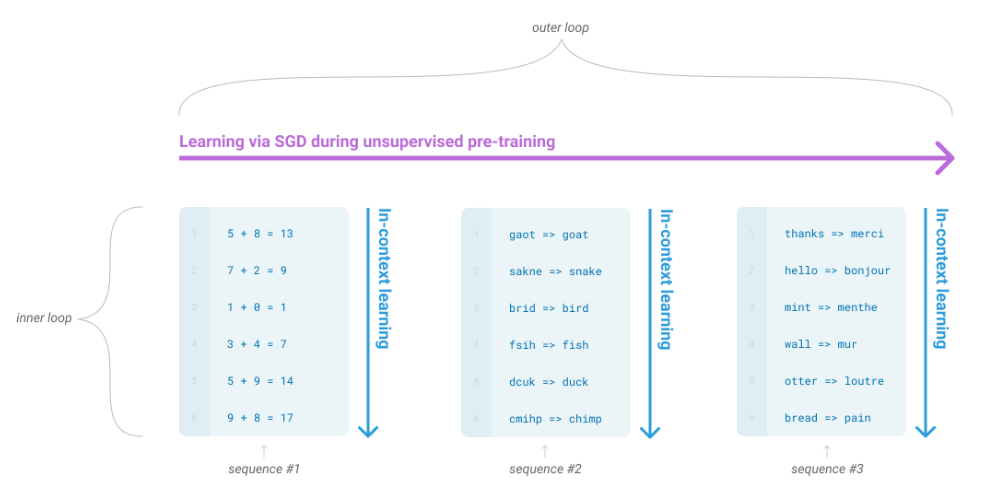

这是一种解释框架，不能简单等同于显式优化内外循环的 MAML，也不能把课件“没有继续被认可”写成定论。ICL 的表现与训练分布、提示顺序、示例相关性、窗口和模型规模有关，多给例子不保证改善。

示例过长会挤占输入与生成预算。固定权重的 ICL 不会把本次示例永久写入参数，新的独立请求通常需再次提供上下文。KV Cache 等推理缓存复用与参数学习是不同机制，见[第 5 章](05-llama-advancements.md#gqa-cache)。传统微调不要求 batch=1，课件只是用单个样本更新来画示意图。

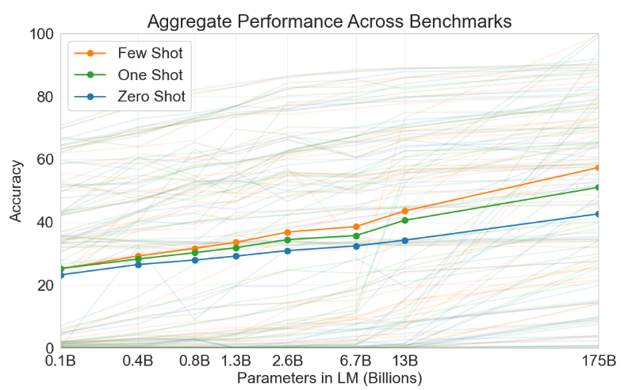

图中淡色线对应各任务，较粗实线是汇总表现。Few-shot 通常更高，规模越大优势更明显，结论仍限于论文数据。

<a id="gpt3-training" name="gpt3-training"></a>
## 8. GPT-3：模型规模、数据与训练

**对应课件第 74–76 页。** GPT-3 延续 GPT-2 的 Pre-LN、初始化和 tokenization，注意力层交替使用 dense 与局部带状 sparse pattern，借鉴 Sparse Transformer。这里的稀疏指**注意力连接模式**，并非断言模型权重中有大量零值。

### 8.1 八种尺寸与全部表格参数

| 模型 | 参数量 | 层数 | 隐藏宽度 | 头数 | 每头维度 | Batch（tokens） | 学习率 |
|---|---:|---:|---:|---:|---:|---:|---:|
| Small | 125M | 12 | 768 | 12 | 64 | 0.5M | 6.0×10⁻⁴ |
| Medium | 350M | 24 | 1,024 | 16 | 64 | 0.5M | 3.0×10⁻⁴ |
| Large | 760M | 24 | 1,536 | 16 | 96 | 0.5M | 2.5×10⁻⁴ |
| XL | 1.3B | 24 | 2,048 | 24 | 128 | 1M | 2.0×10⁻⁴ |
| 2.7B | 2.7B | 32 | 2,560 | 32 | 80 | 1M | 1.6×10⁻⁴ |
| 6.7B | 6.7B | 32 | 4,096 | 32 | 128 | 2M | 1.2×10⁻⁴ |
| 13B | 13.0B | 40 | 5,140（原表） | 40 | 128 | 2M | 1.0×10⁻⁴ |
| 175B | 175.0B | 96 | 12,288 | 96 | 128 | 3.2M | 0.6×10⁻⁴ |

全部模型训练 300B tokens，上下文窗口为 2,048 tokens。Batch 数量单位是 **token**，不是序列数。常规 batch 的不同序列互不做注意力，数据并行只汇总梯度。

**原表一致性说明：**13B 行的 `5140` 在课件与原论文均如此，而 40×128=5,120；XL 行的 24×128=3,072 也不同于隐藏宽度 2,048。不能机械地要求所有结构都有隐藏宽度=头数×头维度，投影后拼接宽度可与残差宽度不同。本笔记保留原表，不把推算值冒充真实实现配置；复现需另核具体实现。

较大模型采用更小学习率、较大 batch 是这组实验配置，不是对所有训练都成立的定律。深度和宽度的计算影响见前述[复杂度](#bert)。

### 8.2 Common Crawl 过滤、去重与混合采样

课件保留三个步骤：按质量过滤 Common Crawl；进行文档级近似去重；混入已知高质量语料。质量分类器以 Common Crawl 作负例、高质量参考数据作正例，使用逻辑回归进行质量估计。LSH/MinHash 用于寻找近重复内容，不应把哈希碰撞自动视为完全相同文本。

补充课件提到的相似度含义：集合 Jaccard 为 $J(A,B)=|A\cap B|/|A\cup B|$ 。计数多重集可以用各元素计数最小值之和除以最大值之和；文本实际可基于 token、词片或 n-gram 构造。去重实现细节与一般定义需分开，不把“文章就是词集合”当成保留文本顺序的表示。

| 数据集 | 数据量（tokens） | 训练混合权重 | 训练 300B tokens 时的原表 epochs |
|---|---:|---:|---:|
| Filtered Common Crawl | 410B | 60% | 0.44 |
| WebText2 | 19B | 22% | 2.9 |
| Books1 | 12B | 8% | 1.9 |
| Books2 | 55B | 8% | 0.43 |
| Wikipedia | 3B | 3% | 3.4 |

原表百分比经过四舍五入，相加为 101%；数量、权重和 epoch 也取了不同精度，不能把它们当精确配置反推。高质量数据相对于库存量被重复采样，混合权重并非各数据集大小的占比。

### 8.3 分布式训练

模型和训练 batch 太大，论文结合数据并行与模型并行，使用高带宽 V100 集群。课件截图注明 V100 GPU、部分 DGX-1 系统，但没有详细给出并行划分方案。数据并行复制模型、拆分 batch 并汇总梯度；模型并行拆分模型参数/计算，二者可结合。课件列出的 V100、4090、A6000、A800、A100、H100、H800、H200、B200 是课堂硬件举例，不代表全部用于 GPT-3 训练。

<a id="gpt3-evaluation" name="gpt3-evaluation"></a>
## 9. GPT-3：评估方法、Scaling Law 与结果

**对应课件第 77–82 页。** 评测从任务训练集采样 K 个示例放入提示，按任务使用换行分隔。K=0 为 zero-shot，K=1 为 one-shot，few-shot 常约 10–100，最大取值由 2,048-token 窗口决定。没有标准训练集的 LAMBADA/Story Cloze 使用开发集示例、在测试集评测；Winograd 的原始单一数据集处理需依照论文说明。

### 9.1 候选评分与生成

多选题给上下文及候选后续文本，比较语言模型似然。一般用每 token 平均对数似然减轻答案长度偏差。ARC、OpenBookQA、RACE 等任务还使用答案的条件/无条件概率比：

$$
\mathrm{score}(a)=\frac{P(a\mid c)}{P(a\mid\mathrm{answer\_context})}.
$$

`answer_context` 为 `Answer: ` 或 `A: `，帮助扣除候选答案自身常见程度的影响。计算上可相减对数概率，避免小概率下溢。二分类使用 `True`/`False` 等自然语义标签，比任意 `0`/`1` 更贴近训练文本模式，但这是一种提示设计，并非保证正确率的规则。

自由生成任务在论文所述设置用 beam width=4、长度惩罚 α=0.6；按任务采用 F1、BLEU 或 exact match。BLEU 衡量翻译的 n-gram 匹配，与训练交叉熵或问答准确率不同，参见[第 3 章](03-transformer.md#loss)。

### 9.2 计算量与验证损失

验证损失用于比较预训练效果，因为训练损失可能包含对训练样本的过拟合。它与下游表现常有关联，但不是每个任务精度的确定映射。

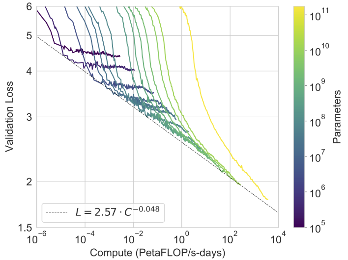

图中虚线近似为 $\mathcal L=2.57\,C^{-0.048}$ ， $C$ 的单位是图中的 PetaFLOP/s-days。该式是经验拟合，计算量乘 $r$ ，损失乘 $r^{-0.048}$ 。在双对数图上表现为近似直线，并非“计算量指数增加就使损失在原始尺度线性下降”。增加计算有递减收益。

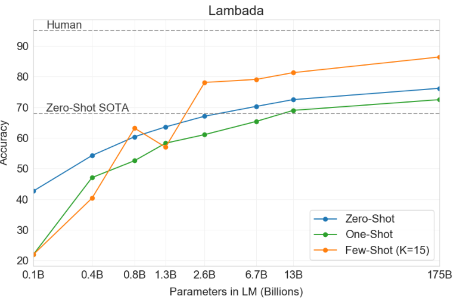

LAMBADA 图的 few-shot 使用 K=15，图中给出人类与 zero-shot 历史基线。大模型更强，但图里的“接近人类”只针对该任务与设置，不能外推为总体通用能力。

### 9.3 开放域问答与机器翻译

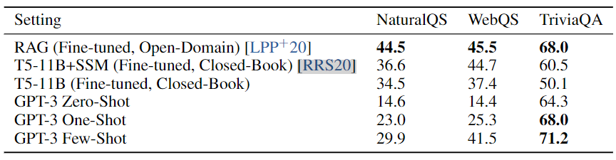

| GPT-3 设置 | Natural Questions | WebQuestions | TriviaQA |
|---|---:|---:|---:|
| Zero-shot | 14.6 | 14.4 | 64.3 |
| One-shot | 23.0 | 25.3 | 68.0 |
| Few-shot | 29.9 | 41.5 | 71.2 |

课件原表同时保留 RAG、T5-11B+SSM、T5-11B 基线。T5 使用 Encoder–Decoder；RAG 的 open-domain 设置与不检索的 closed-book 设置需区分。GPT-3 在 TriviaQA 上与部分微调方法有竞争力，但 Natural Questions/WebQuestions 仍低于表中某些微调系统，不能只引用一个结果宣称普遍胜出。

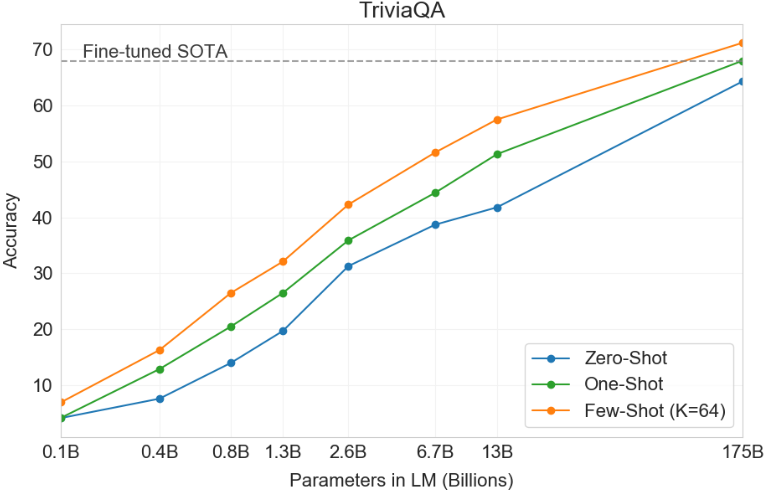

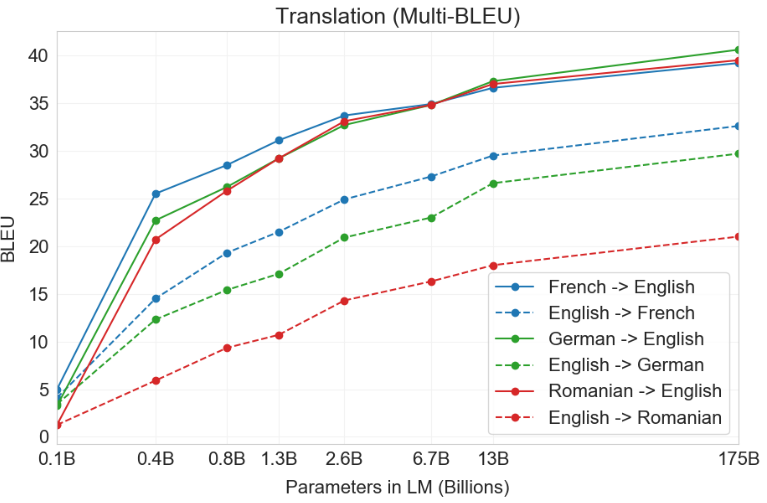

翻译图保留六个方向的成绩趋势，大模型表现通常更好，方向间差距明显。曲线来自特定任务/提示，不表示所有语言具有同等能力。

### 9.4 新闻生成例子


示例展示给定标题、副标题后的新闻式续写，论文图注记录该样本的人类判别准确率为 12%。这是某个样本的判别实验，不能把该数字当作所有生成文本的事实正确率，也不能用“读者难以辨认”证明新闻内容真实。

来源：[Language Models are Few-Shot Learners](https://arxiv.org/abs/2005.14165)。

<a id="gpt3-limitations" name="gpt3-limitations"></a>
## 10. GPT-3：局限性、偏见与误用

**对应课件第 83–86 页。** 课件与论文讨论的限制包括：长篇剧情与全局一致性不足；因果模型只利用左侧历史，而非完整双向输入；按 token 最大似然训练未显式区分每个 token 对任务的重要性；纯文本训练缺少视频、物理世界交互和直接感知经验；样本效率不足；训练的硬件、人力、电力成本高；内部机制可解释性有限。这些描述对应 2020 年 GPT-3，不能直接当作之后所有模型的结论。

课件讨论虚假信息、钓鱼邮件、学术内容造假和课程作业评估等误用问题。性别关联可能过度强调女性外貌，例如 `beautiful`，这属于统计偏见的例子，并非词本身在所有情境都不当。

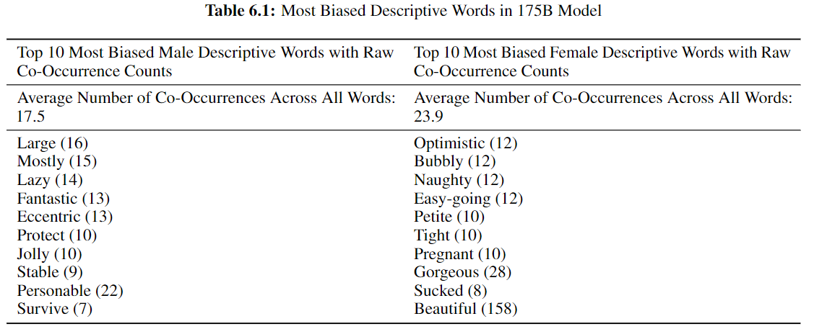

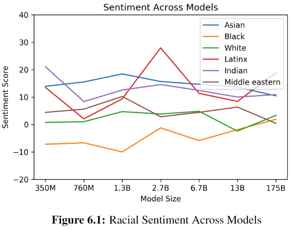

图中组别评价不均衡，反映该提示与情感分类器下的偏见测量，不能用来评价任何现实群体。更大模型也不自动消除偏见。

第 86 页仅罗列 GPT-1、BERT、GPT-2、GPT-3、Llama、Qwen、DeepSeek、GPT-OSS、GPT-5 等后续名称，没有给出新架构或实验，不据此补造参数和排名。Llama 的具体结构改进在[第 5 章](05-llama-advancements.md#architecture)继续展开。
