# 第 5 章：Llama 的 RMSNorm、SwiGLU 与 RoPE

来源：`4.2 大模型进阶2(RMSNorm、Swish、ROPE) 2026秋.pptx`，27 页。完整保留课件中的 Llama 配置、归一化、门控前馈层、位置编码推导与实现要点。GQA、KV Cache 在课件里作为结构名称出现，下文把必要补充单独标明。

## 目录

- [Llama 家族与规模配置](#llama-sizes)
- [Decoder-only 的整体结构](#architecture)
- [RMSNorm 与 LayerNorm：公式、差异和条件](#rmsnorm)
- [pRMSNorm、效率与原始实验](#rmsnorm-performance)
- [Swish、SiLU、GLU 与 SwiGLU](#swiglu)
- [GQA 与 KV Cache 的必要补充](#gqa-cache)
- [绝对位置、相对位置与 RoPE 的目标](#rope-goal)
- [二维旋转与复数内积推导](#rope-2d)
- [多维 RoPE、频率与上下文长度](#rope-general)
- [高效实现、维度配对与检查清单](#rope-implementation)

<a id="llama-sizes" name="llama-sizes"></a>
## 1. Llama 家族与规模配置

**对应课件第 2–3 页。** Llama 家族谱系图与[第 1 章](01-neural-networks.md#history)相同，复用原图。绿色线代表模型权重继承，蓝色线代表数据继承，红色虚线表示继续预训练，空心标记低秩微调、实心标记全参数微调。应用方向包括法律、医学、金融、教育、双语以及多模态。

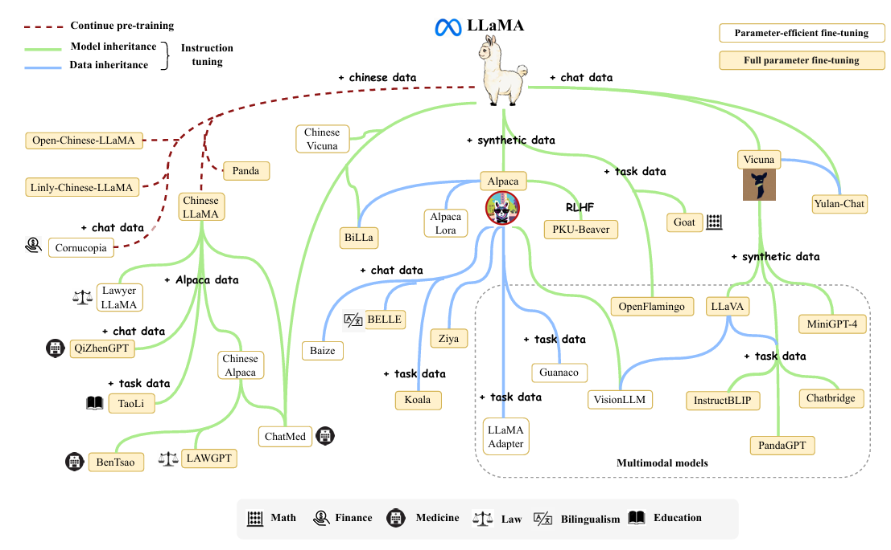

课件备注列举 Chinese LLaMA 的领域分支（Lawyer LLaMA、QiZhenGPT、LAW-GPT、BenTsao）、Alpaca 的合成数据与聊天分支（Baize、BELLE、Ziya、Koala）、PKU-Beaver 的 RLHF 路线，以及 LLaVA、OpenFlamingo、MiniGPT-4、PandaGPT、ChatBridge 的多模态方向。图反映其历史时间范围，数据继承与模型继承不能混为一谈。

### 1.1 课件中的完整规模表

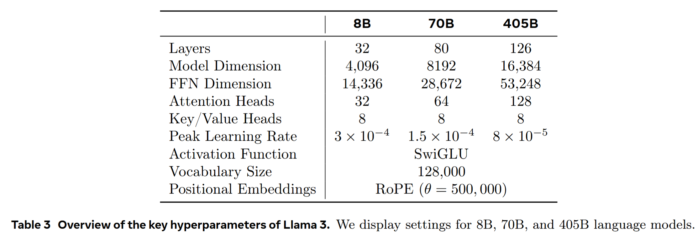

| 配置 | 8B | 70B | 405B |
|---|---:|---:|---:|
| Layers | 32 | 80 | 126 |
| Model Dimension | 4,096 | 8,192 | 16,384 |
| FFN Dimension | 14,336 | 28,672 | 53,248 |
| Query Heads | 32 | 64 | 128 |
| Key/Value Heads | 8 | 8 | 8 |
| 每个 Query Head 的维度（按表计算） | 128 | 128 | 128 |
| 峰值学习率 | 3×10⁻⁴ | 1.5×10⁻⁴ | 8×10⁻⁵ |
| FFN 激活 | SwiGLU | SwiGLU | SwiGLU |
| 词表（论文表取整） | 128,000 | 128,000 | 128,000 |
| RoPE 基数 | 500,000 | 500,000 | 500,000 |

这张包含 405B 的表来自 [The Llama 3 Herd of Models](https://arxiv.org/abs/2407.21783)，论文把 Llama 3.1 系列简称为 Llama 3。不要与仅包含 8B/70B 的最初 Llama 3 发布配置混用。较大尺寸使用更低峰值学习率是表中配置，不是通用优化定律。

### 1.2 “参数随层数线性、宽度平方增长”的条件

固定 FFN/隐藏宽度比例、头的比例及其他结构时，主干参数近似满足 $P\propto Ld^2$ 。课件由 32→80 层和 4,096→8,192 宽度估算 $2.5\times2^2=10$ 倍；由 80→126 层、宽度再翻倍估算 $1.6\times2^2=6.4$ 倍。第二个层数比更精确为 $126/80=1.575$ ，对应 6.3 倍。

这些只是近似值，实际标称模型比为 70/8=8.75 和 405/70≈5.79。FFN 比例也不完全固定：前两档为 3.5d，405B 为 3.25d。词表、输出投影、GQA 的 KV 头数及维度取整都会影响总参数。

**补充计数公式：** 设每层隐藏宽度为 $d$ ，SwiGLU 中间宽度为 $f$ ，KV 拼接宽度为 $d_{\mathrm{KV}}$ ，输入/输出 embedding 不共享、词表为 $V$ ，忽略小型归一化参数：

$$
P\approx L\left(2d^2+2dd_{\mathrm{KV}}+3df\right)+2Vd.
$$

其中 Q 与 O 各贡献 $d^2$ ，K/V 各贡献 $dd_{\mathrm{KV}}$ ，三组 FFN 投影共 $3df$ 。普通多头若 $d_{\mathrm{KV}}=d$ ，注意力项变为 $4d^2$ 。固定 KV 头数时，它不与 d 完全平方同比增长。参数规律也不同于长序列注意力的 $N^2$ 计算/存储增长，见[第 4 章复杂度说明](04-gpt-and-bert.md#bert)。

<a id="architecture" name="architecture"></a>
## 2. Decoder-only 的整体结构

**对应课件第 4–5、11、27 页。** 本课件集中标出四个改动：RMSNorm、SwiGLU、Grouped-Query Attention（GQA）与 KV Cache、Rotary Position Embeddings（RoPE）。RoPE 对 Q/K 作用，KV Cache 属于推理机制，两者不是独立堆叠的残差子层。

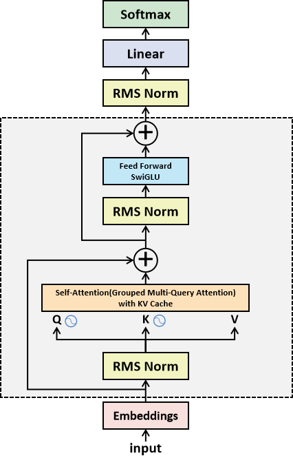

设当前 block 输入为 $x$ ：

$$
u=x+\mathrm{Attention}(\mathrm{RMSNorm}(x)),
\qquad
y=u+\mathrm{FFN}_{\mathrm{SwiGLU}}(\mathrm{RMSNorm}(u)).
$$

Embedding 后重复该 block，最后还有 RMSNorm 和词表线性投影，输出 logits；需要概率时再做 softmax。Decoder 因果掩码与[第 3 章](03-transformer.md#autoregressive)一致。Pre-Norm 将归一化放在注意力/FFN 之前，残差保留直接信息通路。

课件“Pre-LN 不需要 warm-up”应沿用[第 3 章的条件说明](03-transformer.md#normalization)：它在相关论文实验中改善早期梯度稳定性，但不意味着实际大模型均应取消预热，也不保证所有深度与超参数都收敛或性能相同。课件中的“Llama3.2 当时最佳开源模型”是课堂时间性评价，删去排名。

<a id="rmsnorm" name="rmsnorm"></a>
## 3. RMSNorm 与 LayerNorm：公式、差异和条件

**对应课件第 6–8、10 页。** 对一个 token 的隐藏向量 $x\in\mathbb R^d$ 归一化，统计轴是最后的特征维，不跨 token 或 batch。以下补上实现所需的数值稳定常数 $\epsilon$ 。

### 3.1 LayerNorm 的居中与缩放

$$
\mu=\frac1d\sum_{j=1}^d x_j,
\qquad \sigma^2=\frac1d\sum_{j=1}^d(x_j-\mu)^2,
$$

$$
\widehat x_i=\frac{x_i-\mu}{\sqrt{\sigma^2+\epsilon}},
\qquad \mathrm{LN}(x)_i=\gamma_i\widehat x_i+\beta_i.
$$

步骤是计算均值、估计方差、减均值、除标准差，再做可学习仿射变换。未加仿射时均值为 0，方差为 $\sigma^2/(\sigma^2+\epsilon)$ ，在方差远大于 ε 时近似 1。加上逐维 $\gamma,\beta$ 后，不保证最终均值 0 或方差 1。

### 3.2 RMSNorm 只按均方根缩放

$$
\mathrm{RMS}(x)=\sqrt{\frac1d\sum_{j=1}^d x_j^2},
\qquad r_\epsilon(x)=\sqrt{\frac1d\sum_{j=1}^d x_j^2+\epsilon},
$$

$$
\widehat x_i^{\mathrm{RMS}}=\frac{x_i}{r_\epsilon(x)},
\qquad y_i=g_i\widehat x_i^{\mathrm{RMS}}+b_i.
$$

这是课件包含 gain/bias 的一般写法。**Llama 的具体实现只保留可学习缩放 $g_i$ ，没有加性 bias**。其 RMSNorm 在 float32 中计算平方均值与倒平方根，再转回输入 dtype 并缩放，见 [Meta 官方实现](https://github.com/meta-llama/llama3/blob/main/llama/model.py)。

RMSNorm 不减均值，不保证居中；其核心是控制总体幅度。去均值不一定是每种模型获得良好效果的必要条件，这是 RMSNorm 论文提出并实验验证的假设，不能把“更稳定”写成无条件结论。

### 3.3 何时等价，何时差别很大

因为 $\frac1d\sum_i x_i^2=\sigma^2+\mu^2$ ，所以：

$$
\frac{x_i}{r_\epsilon(x)}
=\frac{x_i}{\sqrt{\sigma^2+\mu^2+\epsilon}}.
$$

若均值严格为零，且 ε、gain、bias 相同，二者等价。均值接近零相对于向量的典型幅度足够小，差异才可能较小；不能只看绝对均值数值。均值较大时，差异可很明显。

**补充数值例子，暂忽略 ε 与仿射：**

| 输入 | LayerNorm | RMSNorm |
|---|---|---|
| `[-1, 1]` | `[-1, 1]` | `[-1, 1]` |
| `[1, 3]` | `[-1, 1]` | `[1/√5, 3/√5]`，约 `[0.4472, 1.3416]` |
| `[2, 2]` | `[0, 0]` | `[1, 1]` |

因此“输入均值非零时仅略有差异”并不普遍成立。ε 避免全零向量的除零，非零常量向量的 RMSNorm 与 LayerNorm 也具有不同输出。

### 3.4 均值、方差与分布

在无仿射、ε=0 且 RMS 非零时，RMSNorm 输出的**均方值**为 1，均值可以不为零。方差为：

$$
\mathrm{Var}(\widehat x^{\mathrm{RMS}})
=1-\frac{\mu^2}{\sigma^2+\mu^2}\le1.
$$

课件调音比喻可理解为：LayerNorm 同时调整偏置中心与整体强度；RMSNorm 只调整整体强度。两者都不把任意分布变成高斯分布，不消除任意分布形状。加上仿射参数或 ε 后，需按实际公式重新计算，不能直接套“方差恒为 1”。

<a id="rmsnorm-performance" name="rmsnorm-performance"></a>
## 4. pRMSNorm、效率与原始实验

**对应课件第 7–10 页及备注。** RMSNorm 省去显式居中，减少统计、算术与潜在内存访问；实现更简单、便于融合 GPU kernel。课件备注把 LayerNorm 描述为“两次规约/同步/多次访问”，RMSNorm 描述为“一次 pass”，这有助于理解，但不是所有优化实现都必然使用的内存遍数或 kernel 次数。优化的 LayerNorm 也能融合，并行算法可联合估计均值和方差。

这里的 reduction 是特征维上的规约。普通单设备归一化不意味着分布式训练节点间必然进行一次“全局通信”，也不能断言 RMSNorm 完全无需线程协作。实际收益取决于维度、硬件、融合和精度。

### 4.1 Partial RMSNorm

只取特征子集 $\mathcal S$ 的 p% 分量估计 RMS，再缩放全部特征：

$$
r_{\mathcal S}=\sqrt{\frac1{|\mathcal S|}\sum_{i\in\mathcal S}x_i^2+\epsilon},
\qquad y_i=g_i\frac{x_i}{r_{\mathcal S}}.
$$

pRMSNorm 减少统计量计算，但引入近似误差。用子集估计时，整个向量的输出方差不必≤1，也不能保证全向量均方值恰为 1。它是论文的近似变体，不是说本课件的 Llama 已采用 pRMSNorm。

### 4.2 原始实验的全部结果

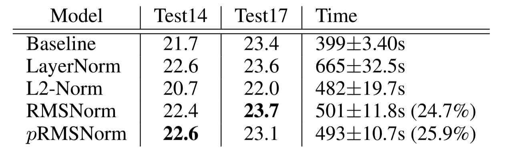

| 方法 | Test14 | Test17 | Time（秒） |
|---|---:|---:|---:|
| Baseline | 21.7 | 23.4 | 399±3.40 |
| LayerNorm | 22.6 | 23.6 | 665±32.5 |
| L2-Norm | 20.7 | 22.0 | 482±19.7 |
| RMSNorm | 22.4 | 23.7 | 501±11.8 |
| pRMSNorm | 22.6 | 23.1 | 493±10.7 |

相对于 LayerNorm，RMSNorm 的时间下降 $\frac{665-501}{665}\approx24.7\%$ ，pRMSNorm 下降约 25.9%。论文在不同模型上的时间减少范围为 7%–64%，课件“平均 25%”应理解为这张表的结果，不能套到任意 Llama/GPU 的整体训练时间。

来源：[Root Mean Square Layer Normalization](https://arxiv.org/abs/1910.07467)。

<a id="swiglu" name="swiglu"></a>
## 5. Swish、SiLU、GLU 与 SwiGLU

**对应课件第 12–15 页及备注。** 先区分单个激活函数与带门控的 FFN，避免把它们都当作同一标量函数。

### 5.1 Swish 与 SiLU

$$
\mathrm{Swish}_\beta(z)=z\,\sigma(\beta z),
\qquad \sigma(z)=\frac1{1+e^{-z}}.
$$

β=1 时与 SiLU 相同。它平滑、在负区间保留部分非零响应，也有非单调区间。β 可作为设定值或可学习参数，但 Llama 的 `silu` 使用 β=1。

$$
\frac{d}{dz}\mathrm{Swish}_\beta(z)
=\sigma(\beta z)+\beta z\sigma(\beta z)\bigl(1-\sigma(\beta z)\bigr).
$$

$$
\lim_{\beta\to0}\mathrm{Swish}_\beta(z)=\frac z2,
\qquad
\lim_{\beta\to+\infty}\mathrm{Swish}_\beta(z)=\max(0,z).
$$

**勘误：** 课件写 β→0 时趋近 y=x，但按所给公式应为 y=x/2，仍是线性函数。β→+∞ 的 ReLU 极限要说明趋向方向。

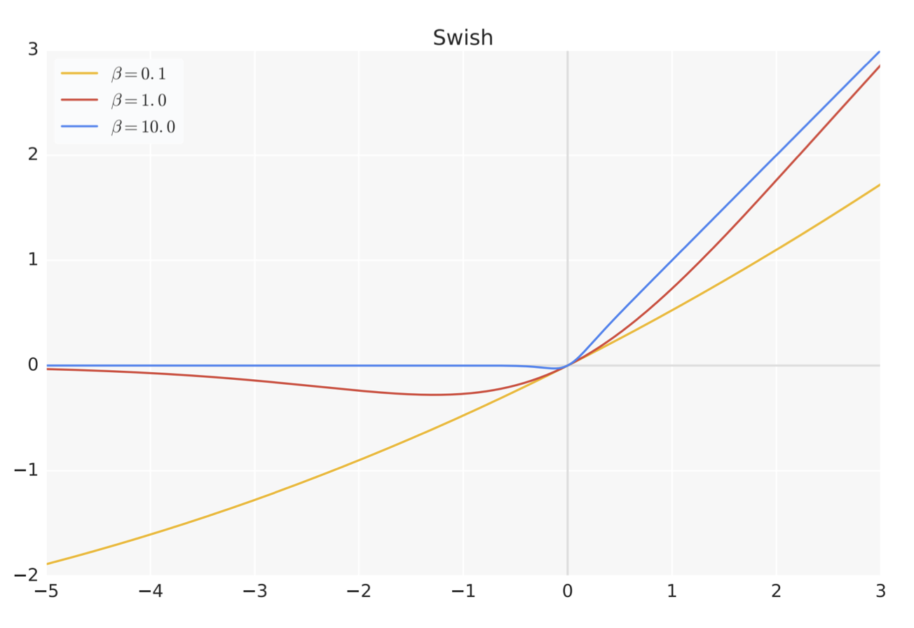

来源：[Searching for Activation Functions](https://arxiv.org/abs/1710.05941)。

### 5.2 GLU 与门控

原始 GLU 用两个线性投影，一路 sigmoid 作门，另一路内容通道，逐元素相乘：

$$
\mathrm{GLU}(x)=\sigma(xW+b)\odot(xV+c).
$$

课件中 W1/W2 名称可交换，关键是明确哪一路激活、哪一路线性。 $\odot$ 是同形状元素相乘，不是矩阵乘法。sigmoid 门值在 (0,1)，但用 Swish 替换后的门值可负且无上界，不能再把它解释成严格的“开关概率”。

### 5.3 SwiGLU 的完整前馈层

$$
\mathrm{SwiGLU}(x;W,V)=\mathrm{Swish}_1(xW)\odot xV,
$$

$$
\mathrm{FFN}_{\mathrm{SwiGLU}}(x)
=\bigl(\mathrm{SiLU}(xW_1)\odot xW_3\bigr)W_2.
$$

行向量约定下， $W_1,W_3\in\mathbb R^{d\times f}$ ， $W_2\in\mathbb R^{f\times d}$ ，逐位置计算。W1 是经 SiLU 的门控支路，W3 是线性内容支路，W2 投影回残差宽度。Llama 使用无 bias 的线性层；课件所列 b1/b2/b3 是一般带 bias 版本的扩展，不能当作 Llama 实现参数。

课件的等价 PyTorch 表达式为：

```python
return self.w2(F.silu(self.w1(x)) * self.w3(x))
```

三组线性层的作用不是对单个激活“多加几个参数”，而是改变整个 FFN 的结构。

**宽度与参数勘误：** 传统两投影 FFN 的参数约 $2df$ ，SwiGLU 三投影约 $3df$ 。若标准 FFN 中间宽度为 4d，为保持相近参数量可令 SwiGLU 的 f≈8d/3，再按硬件友好的倍数取整或调整。实际 Llama 配置见本章表：3.5d/3.25d，而非课件说的固定“升降维 4 倍”。

### 5.4 实验与可解释的直觉

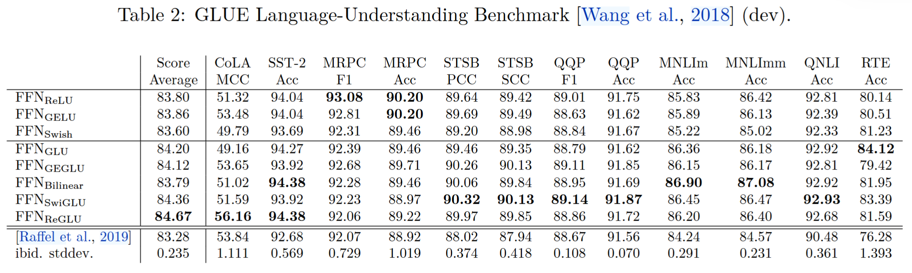

原表保留 ReLU、GELU、Swish、GLU、GEGLU、Bilinear、SwiGLU、ReGLU 及参考系统，各任务的 MCC/Acc/F1/PCC/SCC 等指标不同。平均 Score 中 ReLU=83.80、GELU=83.86、SwiGLU=84.36、ReGLU=84.67。该表没有显示 SwiGLU 在每个单项都最好。

课件给出的解释可分为：平滑的负区间响应减轻 ReLU 的硬截断；内容和门控相乘提供更丰富的条件非线性；投影参数可通过训练适应任务。它们有助于理解，但不构成必然提升长程建模、收敛或泛化的证明。PaLM、Llama 等采用 SwiGLU 是具体模型设计与实验结果。

原论文也没有给出成功原因的完备理论。三投影增加计算，不能只比较 SiLU 与 GELU 的标量计算就宣称整个 SwiGLU FFN 必然更快。性能取决于 f、参数预算和 kernel。课件中的太极图与幽默引语删去，保留技术含义及[GLU Variants Improve Transformer](https://arxiv.org/abs/2002.05202)来源。

<a id="gqa-cache" name="gqa-cache"></a>
## 6. GQA 与 KV Cache 的必要补充

**课件第 4–5 页仅点名这些组件；本节公式是为理解整图补充。** GQA 为 Grouped-Query Attention，比“Grouped Multi-Query Attention”更准确：多个 query heads 分组共享 K/V heads。它介于普通 MHA 与所有 query 共用一个 KV head 的 MQA 之间。

设 query 头数为 $H_q$ ，KV 头数为 $H_{\mathrm{KV}}$ ，分组大小为 $g=H_q/H_{\mathrm{KV}}$ ，需满足整除。课件 8B/70B/405B 配置对应 g=4/8/16。每个 query head 仍有自己的查询和注意力分布，但组内使用相同 K/V。

自回归推理中，KV Cache 保存历史 token 各层的 K/V。下一步只计算新增 token 的 Q/K/V，并读取历史缓存；不需要每次为全部历史重复计算投影。因果 Transformer 中旧位置表示不依赖未来，因此可缓存。缓存不永久改变模型权重。

补充缓存元素数，忽略元数据和 padding：

$$
N_{\mathrm{cache}}=2BLTH_{\mathrm{KV}}d_h,
\qquad \mathrm{bytes}=N_{\mathrm{cache}}\times\mathrm{bytesPerElement}.
$$

B 为 batch，L 为层数，T 为缓存长度，2 对应 K 与 V。相同其他配置下，GQA 相对 MHA 的 KV 存储比约为 $H_{\mathrm{KV}}/H_q$ 。它不把长序列 attention 的所有计算都减少同样倍数。

实现时先给新增 Q/K 做 RoPE，再把旋转后的 K 和未旋转的 V 写入缓存；读取历史 K 时不能重复施加它已获得的位置旋转。官方实现与维度配对见[第 10 节](#rope-implementation)。

<a id="rope-goal" name="rope-goal"></a>
## 7. 绝对位置、相对位置与 RoPE 的目标

**对应课件第 16–20 页。** Self-attention 本身不把 token 的顺序当作位置，需加入位置信息。

绝对位置表示为每个位置提供向量，常在 embedding 上相加。它可用固定正弦函数，也可学习，课件“绝对位置编码是固定向量”不能泛化到所有形式。相对位置方法在 token 对的注意力中表达位置差，如 m−n，可使用相对向量、偏置或旋转，不都需要显式建立一份距离向量。

课件引用 [Self-Attention with Relative Position Representations](https://arxiv.org/abs/1803.02155) 与 [RoFormer](https://arxiv.org/abs/2104.09864)。RoPE 是在 Q/K 的二维子空间施加随位置变化的旋转，让它们的点积中包含相对位置。

### 7.1 符号与目标等式

| 符号 | 含义 |
|---|---|
| $x_m,x_n$ | m/n 位置的 token 内容表示 |
| $W_q,W_k$ | 映射到 query/key 空间的学习矩阵 |
| $q_m=W_qx_m,k_n=W_kx_n$ | 加位置之前的 query/key，以下采用列向量 |
| $f_q,f_k$ | 结合内容与位置的编码函数 |
| $\widetilde q_m,\widetilde k_n$ | 旋转后的 Q/K |
| $R_m,R_n$ | 对应位置的旋转矩阵 |
| $g(x_m,x_n,n-m)$ | 带相对位置差的点积函数 |

$$
\widetilde q_m=f_q(x_m,m),\qquad
\widetilde k_n=f_k(x_n,n),\qquad
\widetilde q_m^\top\widetilde k_n=g(x_m,x_n,n-m).
$$

“仅依赖位置差”指在**固定内容向量**时位置作用只通过 n−m 进入，不能说注意力得分完全与词内容无关，也不是说来自更早层的内容状态不受上下文影响。

Q/K 用于 attention **score**，课件的 `store` 是拼写错误；缩放因子 $1/\sqrt{d_h}$ 和 softmax 沿用[第 2 章](02-self-attention.md#qkv)。RoPE 不代替这些缩放，也不保证整体训练永远稳定。

<a id="rope-2d" name="rope-2d"></a>
## 8. 二维旋转与复数内积推导

**对应课件第 21–22、27 页。** 对二维列向量定义：

$$
R(\phi)=\begin{pmatrix}\cos\phi&-\sin\phi\\\sin\phi&\cos\phi\end{pmatrix},
\qquad \widetilde q_m=R(m\theta)q_m,
\quad \widetilde k_n=R(n\theta)k_n.
$$

**公式勘误：** 第 27 页二维图的右上元素误写成 `−sin cos mθ`。正交旋转矩阵应为 $-\sin(m\theta)$ ，否则后面的正交性与相对位置推导不成立。

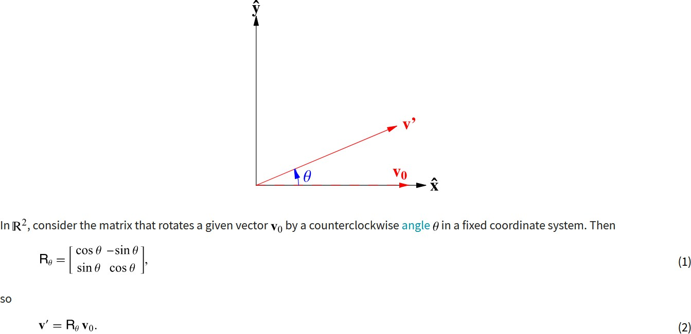

### 8.1 为什么能表示相对位置

旋转满足 $R(\phi)^\top=R(-\phi)$ 与 $R(a)R(b)=R(a+b)$ ：

$$
\widetilde q_m^\top\widetilde k_n
=q_m^\top R(m\theta)^\top R(n\theta)k_n
=q_m^\top R((n-m)\theta)k_n.
$$

整体给两个位置同时加相同偏移不会改变这一点积，保留相对距离。R 为正交矩阵，单个向量的欧氏范数不变，但**不同位置各自旋转后的两向量点积可以改变**；保范数并不等于保所有注意力分数。

### 8.2 复数表达与实部

把 $q=(q_0,q_1)$ 表示为 $z_q=q_0+iq_1$ ，同理 $z_k=k_0+ik_1$ ，二维旋转等于乘单位复数 $e^{im\theta}$ ：

$$
\widetilde z_q=z_qe^{im\theta},\qquad
\widetilde z_k=z_ke^{in\theta}.
$$

$$
\widetilde q_m^\top\widetilde k_n
=\mathrm{Re}\!\left[\widetilde z_q\overline{\widetilde z_k}\right]
=\mathrm{Re}\!\left[z_q\overline{z_k}e^{i(m-n)\theta}\right].
$$

共轭把第二个相位反号，实部把复数乘积转成原二维实向量的点积。复数式用 m−n，前面实矩阵式用 n−m，二者因共轭/向量乘积排列的约定而一致，不能混改其中一个符号。

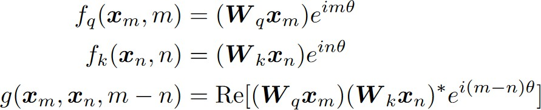

课件要求内积“实数且大于 0”需要区分：自内积 $\langle a,a\rangle$ 为非负，零向量取 0；非零向量才严格正。两个不同实向量的点积可以负、零或正；复数 Hermitian 内积在不同向量之间也可以为复数，RoPE 此处取实部对应二维实点积。

### 8.3 原图角度与数值例子

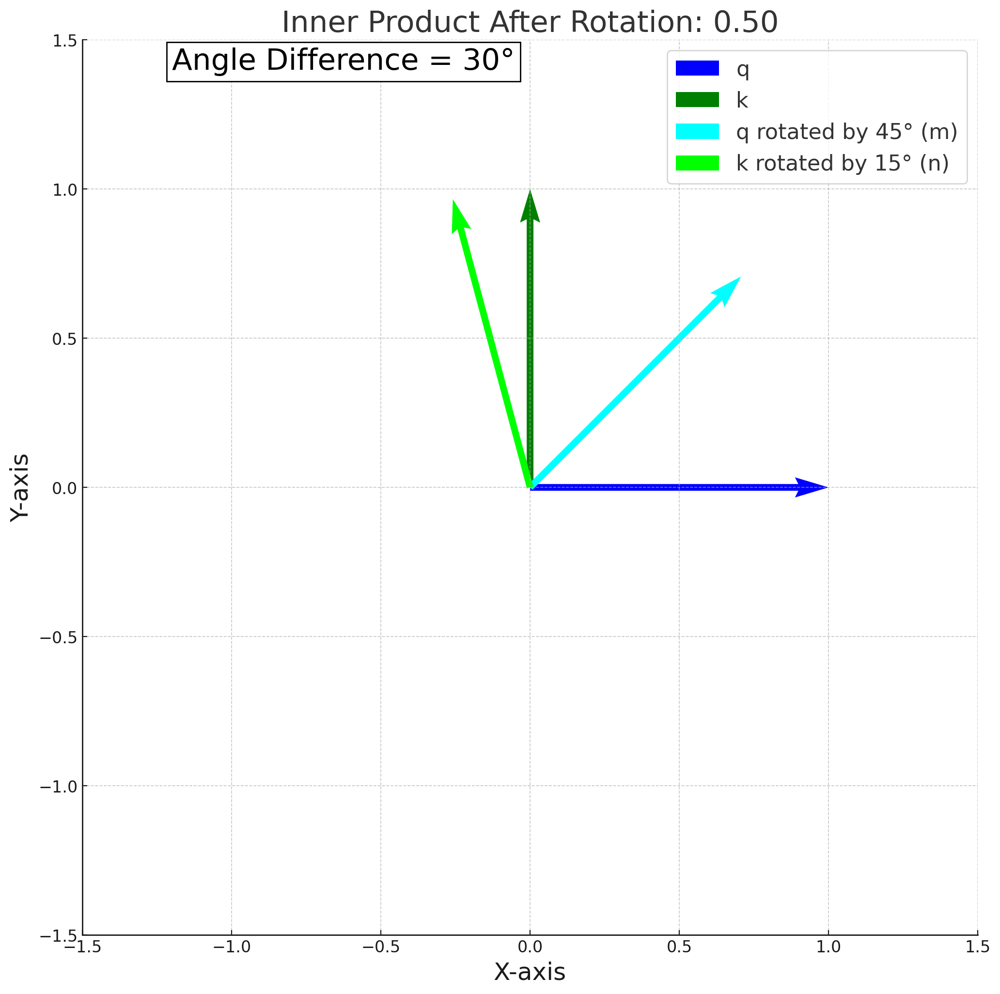

图中的 $q=(1,0)$ 、 $k=(0,1)$ ，q 旋转 45° 后方向为 45°，k 旋转 15° 后方向为 105°。**施加的旋转角之差是 30°，旋转后向量夹角是 60°**，因此点积为 cos60°=0.5，与图标题的数值一致；图框写 `Angle Difference = 30°` 不可当作最终向量夹角。

$$
\widetilde q=(\tfrac{\sqrt2}{2},\tfrac{\sqrt2}{2}),
\qquad
\widetilde k=(-\sin15^\circ,\cos15^\circ),
\qquad \widetilde q^\top\widetilde k=0.5.
$$

<a id="rope-general" name="rope-general"></a>
## 9. 多维 RoPE、频率与上下文长度

**对应课件第 23–24、27 页。** 对一个注意力头中偶数维的 Q/K，把 d 维分成 d/2 个二维子空间。每一对使用不同角频率：

$$
\theta_j=b^{-2j/d},\qquad j=0,1,\ldots,d/2-1.
$$

课件使用从 1 开始的下标，等价为 $\theta_i=10000^{-2(i-1)/d}$ 。b 是**频率基数**，不能把它与单个旋转角混称为 θ。这里 d 是每个 head 的 rotary 维度，不是整个模型的隐藏宽度；某些模型只旋转部分 head 维度。

$$
R_m=\mathrm{diag}\bigl(R(m\theta_0),R(m\theta_1),\ldots,R(m\theta_{d/2-1})\bigr),
\qquad \widetilde q_m=R_mq_m.
$$

$$
\widetilde q_m^\top\widetilde k_n=q_m^\top R_{n-m}k_n.
$$

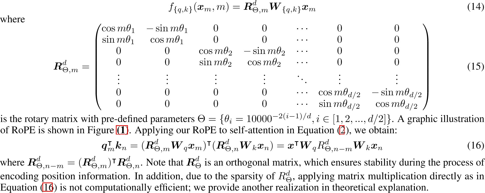

### 9.1 为什么选择几何频率

频率随维度呈几何序列，覆盖不同尺度：高频子空间更敏感于近距离变化，低频子空间具有更长的旋转周期。周期为 $2\pi/\theta_j$ 。这是设计选择，不是唯一满足相对位置恒等式的频率；正弦位置编码中也使用多尺度频率。

**补充例子：** d=4、b=10,000 时频率为 `(1, 0.01)`；位置 m=2 时，两对子空间的旋转角为 `(2, 0.02)` 弧度。换为 b=500,000 后第二个频率约 0.0014142，位置 2 的角约 0.0028284，第一对仍为频率 1。

### 9.2 基数不等于最大上下文长度

课件第 23 页写“把 10,000 改成 500,000，支持 32,768 窗口”。基数增大可改变较低频部分的尺度，但不能单独保证某个上下文长度。

[最初 Llama 3 官方模型卡](https://github.com/meta-llama/llama3/blob/main/MODEL_CARD.md)记录 8B/70B 的 8,192-token 训练窗口；包含 405B 的 Llama 3.1 论文描述进一步进行长上下文训练，最终支持 128K。本文表格与代码片段按所述版本使用，32,768 应看作课件单独举出的数值，不能作为整个系列的官方窗口。

窗口长度还涉及训练长度、继续训练、位置缩放策略、模型配置和显存。正交性保证旋转本身保范数，不能因此保证超出训练分布的长度仍保持性能。

<a id="rope-implementation" name="rope-implementation"></a>
## 10. 高效实现、维度配对与检查清单

**对应课件第 24–27 页。** 显式建立 d×d 稀疏旋转矩阵会浪费计算与存储。每一对只需要 cos/sin 和元素运算：

$$
\begin{pmatrix}x'_{2j}\\x'_{2j+1}\end{pmatrix}
=\begin{pmatrix}
x_{2j}\cos(m\theta_j)-x_{2j+1}\sin(m\theta_j)\\
x_{2j}\sin(m\theta_j)+x_{2j+1}\cos(m\theta_j)
\end{pmatrix}.
$$

定义 $\mathrm{rotatePair}(x)=(-x_1,x_0,-x_3,x_2,\ldots)$ ，把每一对的 cos/sin 重复到两个坐标，可写为：

$$
\mathrm{RoPE}(x,m)=x\odot\cos_m+\mathrm{rotatePair}(x)\odot\sin_m.
$$

每个向量的元素运算为 O(d)，无需 O(d²) 的稠密矩阵乘法。这只表示**施加 RoPE**的成本，注意力整体仍须计算 token 间匹配。

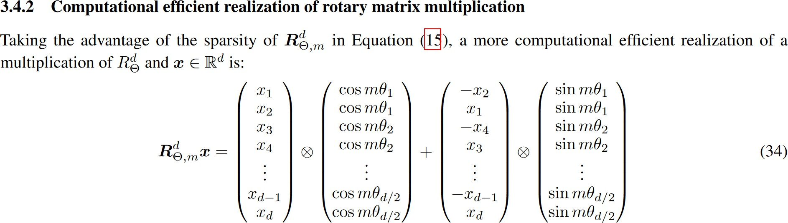

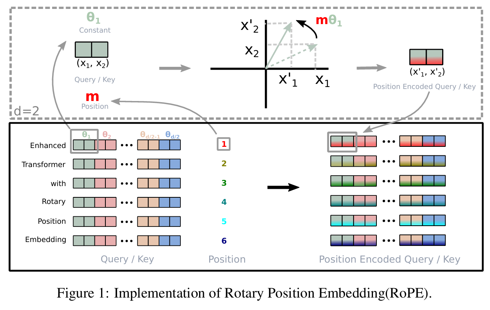

### 10.1 配对与布局

课件提出“真实实现是否配相邻维度”。[Meta 的 Llama 3 实现](https://github.com/meta-llama/llama3/blob/main/llama/model.py)将 Q/K reshape 成最后一维的二维对，转为复数乘预计算相位，再转回实数，属于相邻配对。另一些实现使用 split-half 配对，把前半与后半对应维度作为一对。这可在正确重排权重/向量后等价，但不能直接混用配对顺序、频率广播布局或 checkpoint。

以下补充展示相邻配对版本。输入为 `(batch, tokens, heads, head_dim)`，`positions` 是该批 token 的绝对位置，head_dim 必须为偶数。K 的 heads 可少于 Q（GQA），两者各自应用相同位置相位。

```python
import torch

def rope_adjacent(x, positions, base=500000.0):
    # x: [B, T, H, D]; positions: [T]
    d = x.shape[-1]
    assert d % 2 == 0 and positions.numel() == x.shape[1]
    inv_freq = base ** (-torch.arange(0, d, 2, device=x.device).float() / d)
    angles = positions.to(device=x.device, dtype=torch.float32)[:, None] * inv_freq
    c = angles.cos()[None, :, None, :]
    s = angles.sin()[None, :, None, :]
    pairs = x.float().reshape(*x.shape[:-1], d // 2, 2)
    even, odd = pairs[..., 0], pairs[..., 1]
    rotated = torch.stack((even * c - odd * s, even * s + odd * c), dim=-1)
    return rotated.flatten(-2).to(x.dtype)
```

### 10.2 在 attention 中的顺序

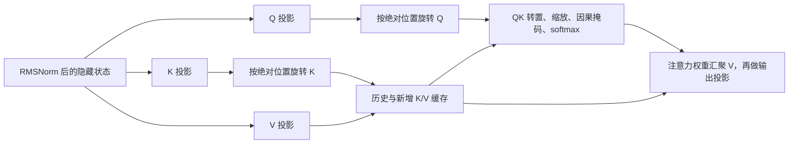

因果 mask 控制可见位置，RoPE 编码位置，两者承担不同功能。历史缓存存在时新增位置从缓存长度继续编号，不能每一步都从 0 重置。原始 RoFormer 讨论的其他变体可能对 V 也做处理，但本课件的 Llama 路线按其官方实现只旋转 Q/K。

### 10.3 实现检查

- 统计轴：RMSNorm 在每 token 的特征维，ε 与 checkpoint 配置一致，Llama 不增加 bias。
- FFN：W1/W3 输出同宽、先 SiLU 再逐元素乘、W2 回到残差宽度；不误设固定 4d。
- 注意力头：GQA 的 query/KV 头数按分组整除；RoPE 使用 head 内维度。
- 位置：旋转频率下标、位置偏移、相邻/split-half 布局与模型权重一致。
- 缓存：K 旋转一次后保存，V 不重复旋转，历史位置不重置。
- 数值：检查 $R^\top R=I$ 、旋转前后范数相等，以及带位置 Q/K 点积与 $q^\top R_{n-m}k$ 一致；误差容限应按 dtype 设定。

来源：课件的旋转矩阵示意注明 [Wolfram MathWorld](https://mathworld.wolfram.com/RotationMatrix.html)，公式推导主要引自 [RoFormer](https://arxiv.org/abs/2104.09864)，部分课件图注明 [Umar Jamil 的 pytorch-llama-notes](https://github.com/hkproj/pytorch-llama-notes)。原图均从提供的 PPT 提取；补充实现用于说明维度、位置和计算约定。
